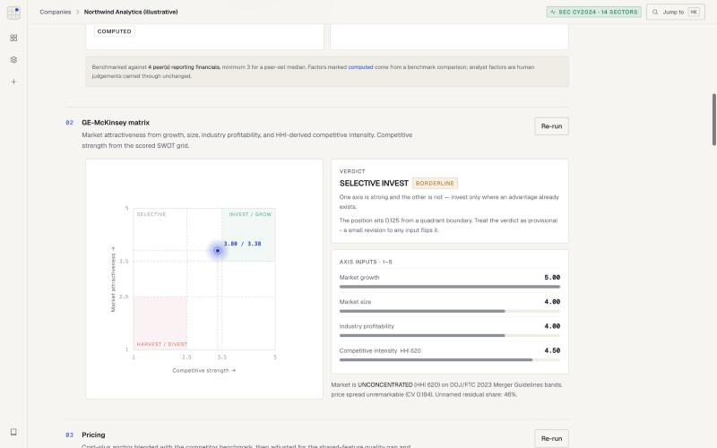
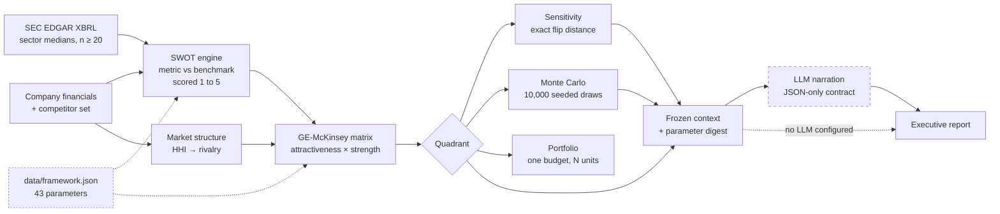
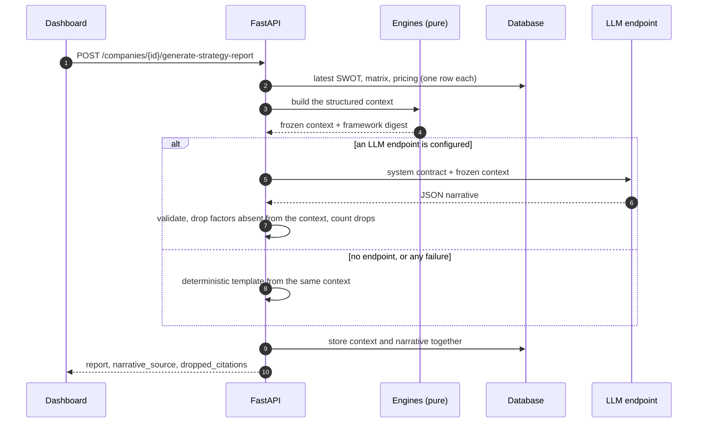
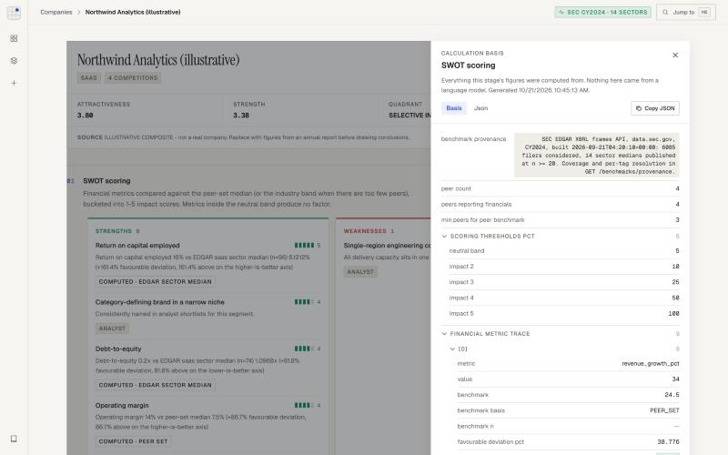
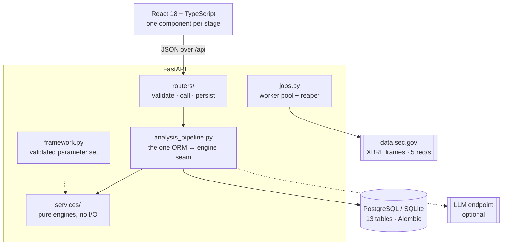
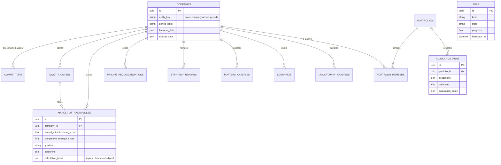
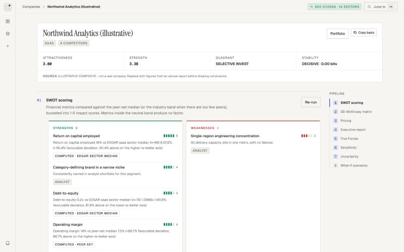
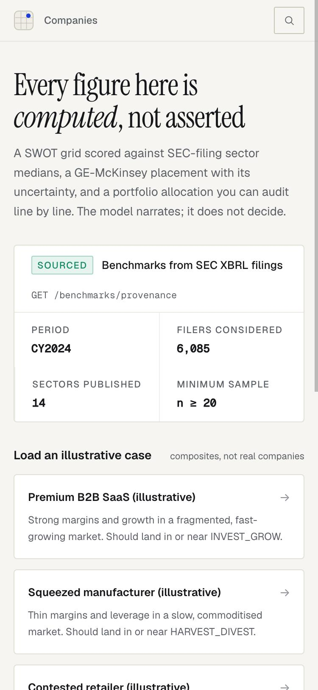

<p align="center">
  
  
</p>

<p align="center">
  <b>Strategy frameworks that are computed, not asserted.</b><br>
  Every figure comes from a deterministic engine and can be recomputed from what is stored beside it.
</p>

<p align="center">
  <a href="https://github.com/IshaanS0112/StrategySphere/actions/workflows/ci.yml"></a>
  <a href="backend/tests"></a>
  <a href="backend/requirements.txt"></a>
  <a href="backend/app/main.py"></a>
  <a href="docs/validation_results.md"></a>
  <a href="LICENSE"></a>
</p>

<p align="center">
  <a href="#how-it-works">How it works</a> ·
  <a href="#a-worked-example">Worked example</a> ·
  <a href="#architecture">Architecture</a> ·
  <a href="#quick-start">Quick start</a> ·
  <a href="docs/PRD.md">PRD</a> ·
  <a href="docs/TRD.md">TRD</a> ·
  <a href="docs/validation_results.md">Validation</a>
</p>

---

SWOT, competitive positioning and pricing are taught as frameworks and applied as
opinions. Someone writes *"strong brand"* in the strengths box and nobody asks what
it was measured against.

StrategySphere is the version where the boxes are computed. A SWOT grid scored
against sector medians built from **6,085 SEC EDGAR filers**, a GE-McKinsey matrix,
Porter's Five Forces, exact sensitivity analysis, Monte-Carlo uncertainty, and
portfolio capital allocation. A language model writes the executive summary, but
only from a context frozen before the call, and any factor it cites that is not in
that context is discarded and counted.

It has also been tested against reality. Across 2,979 company-years the framework
**does not predict** revenue growth. [That result is published in full.](docs/validation_results.md)



---

## How it works



Solid arrows are arithmetic. Dotted arrows are the parameters in force. The dashed
node is the **only** place a model speaks, and removing it degrades the report to a
deterministic template rather than breaking it.

| Stage | Input | Output | Decided by |
|---|---|---|---|
| **SWOT** | Financials + peer set | 1–5 impact factors, each with its evidence | Benchmark arithmetic |
| **Market structure** | Competitor revenue shares | HHI on DOJ/FTC 2023 bands → rivalry score | Derived, never typed in |
| **Matrix** | The two axes | Quadrant, flagged `borderline` within 0.15 of a boundary | Documented thresholds |
| **Pricing** | Cost base, rivals, feature gap | Range floored at cost, with realised margin | Cost-plus / market blend |
| **Five Forces** | HHI, margins, cost share | Composite, and how many forces were actually scored | Computed or analyst, tagged |
| **Sensitivity** | The matrix inputs | Minimum single-input change that flips the quadrant | Solved, not searched |
| **Uncertainty** | `{low, mode, high}` estimates | Quadrant probabilities, 90% CI, entropy | PERT, seeded |
| **Portfolio** | N scored units, one budget | Allocation under floors, unfunded units named | Labelled project rule |
| **Report** | The frozen context | Narrative, uncited factors dropped | The model, on a leash |

A metric inside the ±5% neutral band produces nothing — four empty quadrants is a
valid output. Market share is declared **not derivable** from XBRL rather than guessed.

### The guarantee, step by step



The model never sees raw data and never produces a number. It can only describe
figures that already exist, and the validator removes anything it invents.

---

## A worked example

*Northwind Analytics* is an illustrative SaaS composite with four named competitors,
scored against the shipped CY2024 EDGAR table. Every number below is what the
system actually returns.

| | What the engine did | Result |
|---|---|---|
| **1 · SWOT** | Revenue growth 34.0% vs peer-set median 24.5% → +38.8% favourable → bucket 25–50% | Impact **3** |
| | Return on capital 16% vs EDGAR SaaS median 6.1% (n = 96) → +161% | Impact **5** |
| | | 8 strengths · 1 weakness · 2 opportunities · 1 threat |
| **2 · Market** | HHI 620 over competitor shares → UNCONCENTRATED | Rivalry **4.5 / 5** |
| **3 · Matrix** | 0.3·5 + 0.2·4 + 0.3·4 + 0.2·(6 − 4.5) | Attractiveness **3.80**, strength **3.375** |
| | Strength sits 0.125 below the 3.5 threshold | **SELECTIVE_INVEST**, borderline |
| **4 · Sensitivity** | Smallest single change that flips the verdict | Strength **+0.125** → INVEST_GROW · *KNIFE_EDGE* |
| **5 · Uncertainty** | Strength as {3.0, 3.375, 3.8}, 10,000 PERT draws | 75.1% SELECTIVE · 24.9% INVEST_GROW · 0.81 bits · *LEANING* |
| **6 · Pricing** | Cost-plus anchor blended with four rivals, quality-adjusted | 1,002 – **1,113** – 1,225 · 56.9% margin · HIGH |
| **7 · Report** | No LLM endpoint configured | Template narration, same figures, digest `8dcd4fb4ef54` |

Every stage has an **Inspect** button that opens exactly this trace from the stored
`calculation_basis`, so the arithmetic above can be checked on screen:



---

## Architecture



| Decision | Why |
|---|---|
| Engines are pure functions over dicts | Every one is testable with no database and no network |
| One seam between ORM and engines | `analysis_pipeline.py` is the only module that knows both |
| Every parameter in a versioned file | Validated as a set (weights sum to 1, thresholds ordered); its digest is stamped into every result |
| Reads fetch one row, not a collection | The timeline went from 13 queries / 600 rows to 3 queries / 12 |
| Errors are RFC 9457 `problem+json` | One closed set of machine codes, including FastAPI's own errors |
| Slow work is a job, not a request | `202 Accepted`, progress, cancellation, heartbeats, a reaper |
| Outbound calls only in `edgar/` | Host allowlist, token bucket under the SEC's published ceiling |
| Narration is provider-neutral | Any OpenAI-compatible endpoint, hosted or local |

<details>
<summary><b>Data model</b> — 13 tables</summary>



Every result table cascades from `companies` and carries a `calculation_basis`.
`jobs` stands alone: the row, not the process, is the source of truth.
</details>

---

## Does the framework predict anything?

**No.** Two three-year windows, 2,979 company-years, all scored through the real
pipeline from XBRL filings, against a baseline that uses revenue growth alone:

| Window | Rank correlation with outcome | vs baseline | Reading |
|---|---|---|---|
| CY2020 → CY2023 | **−0.084** (p = 0.0025) | Baseline −0.103 | *Inverted*: HARVEST units grew 16.7%/yr vs 10.4% |
| CY2021 → CY2024 | −0.026 (p = 0.31) | Baseline +0.036 (p = 0.16) | Indistinguishable from chance |

The CY2020 inversion is pandemic-trough mean reversion: the framework read one bad
year as a steady state. The look-ahead bias, the survivorship bias, and three
structural findings about the construction are all in
[validation_results.md](docs/validation_results.md). What this licenses: the output
is a structured summary of stated position, **not a forecast**.

---

## Quick start

```bash
git clone https://github.com/IshaanS0112/StrategySphere.git
cd StrategySphere && docker compose up --build
python backend/scripts/load_case_study.py data/case_studies/premium_saas.json --run-all
```

Dashboard on **http://localhost:5173**, interactive API docs on **http://localhost:8000/docs**.

No API key is needed. To add narration, point it at any OpenAI-compatible endpoint:

```bash
export LLM_BASE_URL=http://localhost:11434/v1 LLM_MODEL=llama3.1   # e.g. a local Ollama
```

Bare-metal setup, rebuilding the benchmark table from EDGAR, and install checks are
in [running.md](docs/running.md).

<p align="center">
  
  
</p>

| Shortcut | Action |
|---|---|
| <kbd>⌘</kbd> <kbd>K</kbd> | Jump to any company or view |
| <kbd>G</kbd> then <kbd>C</kbd> / <kbd>P</kbd> / <kbd>N</kbd> | Companies · Portfolio · New company |
| <kbd>?</kbd> | All shortcuts |

---

## Stack

| Layer | Technology |
|---|---|
| API | Python 3.10–3.12, FastAPI, Pydantic v2, SQLAlchemy 2.0, Alembic |
| Data | PostgreSQL 16 (SQLite for tests), SEC EDGAR XBRL frames API |
| Numerics | Standard library only — PERT sampling, permutation tests, Spearman ρ |
| Frontend | React 18, TypeScript, Vite, Tailwind CSS, hand-drawn SVG charts |
| Ops | Docker Compose, GitHub Actions, Prometheus metrics, JSON logs |

## Layout

```
backend/app/services/         the engines: pure functions, no database, no network
backend/app/services/edgar/   the only package that makes outbound calls
backend/app/framework.py      validates the parameter set and computes its digest
backend/app/routers/          HTTP only, thin over the services
backend/alembic/              four migrations, each reversible
backend/tests/                545 tests, no database or network needed
frontend/src/                 shell, command palette, one component per stage
data/framework.json           the 43 parameters that can change a figure
data/benchmarks/              the shipped CY2024 table built from SEC filings
data/validation/              two real EDGAR panels behind the published backtest
docs/                         PRD · TRD · design · methodology · validation · running
```

Start with `swot_engine.py` → `attractiveness_matrix.py` → `analysis_pipeline.py`.
That is the spine.

## Docs

| | |
|---|---|
| [PRD](docs/PRD.md) | Flows, features by version, non-goals, and what the product may not claim |
| [TRD](docs/TRD.md) | Architecture, schema, the full API map, security posture, risks |
| [Design](docs/DESIGN.md) | The token system, the one-accent budget, and how the UI is checked |
| [Architecture notes](docs/architecture.md) | What is real vs simulated, and every bug the live data found |
| [Methodology](docs/methodology.md) | Computed vs narrated, measured results, scope |
| [Validation](docs/validation_results.md) | The backtest in full, including what is wrong with it |
| [Running it](docs/running.md) | Docker, bare metal, rebuilding benchmarks |

## Licence

MIT — see [LICENSE](LICENSE).
